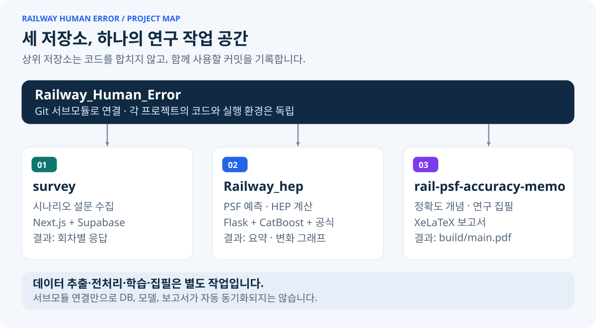
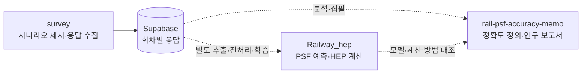
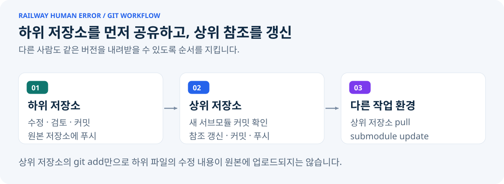

# Railway Human Error

철도 인적 오류 연구의 **설문 수집, PSF·HEP 예측, 연구 문서**를 함께 관리하는 상위 저장소입니다. 세 프로젝트를 Git 서브모듈로 연결하고, 함께 사용할 각 저장소의 커밋을 기록합니다.

이 저장소 자체에는 실행 서버나 통합 빌드가 없습니다. 필요한 하위 프로젝트의 README를 따라 해당 디렉터리에서 설치·실행합니다.

## 목차

- [저장소 구성](#저장소-구성)
- [연구 흐름과 용어](#연구-흐름과-용어)
- [비교 실험과 검증 자료](#비교-실험과-검증-자료)
- [처음 내려받기](#처음-내려받기)
- [프로젝트별 실행](#프로젝트별-실행)
- [서브모듈 버전 관리](#서브모듈-버전-관리)
- [수정하고 공유하기](#수정하고-공유하기)
- [데이터와 배포 관리](#데이터와-배포-관리)
- [문제 해결](#문제-해결)

## 저장소 구성



*그림 1. 세 프로젝트의 역할과 실행 결과. 데이터 추출·학습·집필은 별도 작업입니다.*

| 경로 / 사용 안내 | 원본 저장소 | 담당 역할 | 실행 결과 |
| --- | --- | --- | --- |
| [Railway_hep/](https://github.com/JungWonSeok97/Railway_hep#readme) | [JungWonSeok97/Railway_hep](https://github.com/JungWonSeok97/Railway_hep) | PSF 수준 예측, 직종별 HEP 계산, 시간·월별 변화 시각화 | Flask 웹앱, 기본 포트 8000 |
| [survey/](https://github.com/JungWonSeok97/survey#readme) | [JungWonSeok97/survey](https://github.com/JungWonSeok97/survey) | 무작위 시나리오 설문, 회차별 응답 저장, 관리자 조회 | Next.js 웹앱, 기본 포트 3000 |
| [rail-psf-accuracy-memo/](https://github.com/abitocodes/rail-psf-accuracy-memo#readme) | [abitocodes/rail-psf-accuracy-memo](https://github.com/abitocodes/rail-psf-accuracy-memo) | 전문가 일치 기반 PSF 정확도 정의와 연구 방법 정리 | LaTeX 보고서, `build/main.pdf` |

`.gitmodules`에는 각 경로, 원본 URL, 추적 브랜치 `main`이 정의되어 있습니다. 실제 재현에 사용하는 버전은 상위 저장소의 Git 커밋에 기록된 서브모듈 커밋입니다.

```text
Railway_Human_Error/
├── .gitmodules
├── README.md
├── Railway_hep/              # 독립 Git 저장소
├── survey/                   # 독립 Git 저장소
└── rail-psf-accuracy-memo/    # 독립 Git 저장소
```

## 연구 흐름과 용어



실선은 설문 앱에 구현된 저장 흐름입니다. 점선은 연구 업무의 관계이며, 세 저장소를 자동 연결하는 데이터 파이프라인을 뜻하지 않습니다. Supabase 응답을 예측 모델로 자동 학습하거나 보고서 수치를 자동 갱신하는 통합 기능은 없습니다.

| 용어 | 이 프로젝트에서의 의미 |
| --- | --- |
| PSF | Performance Shaping Factor. 작업부하·환경·교육 등 수행에 영향을 주는 요인 |
| HEP | Human Error Probability. 예측된 PSF 배수와 직종별 계수를 이용해 웹앱에서 계산하는 값 |
| 분류 확률 | 모델이 각 PSF 수준에 부여한 확률. 최종 HEP와 별도 값 |
| EA / TheoAcc | 연구 보고서에서 정의하는 전문가 합의율과 전문가 일치 기반 상대 정확도 |

설문·모델·보고서 사이에 PSF 명칭이나 수준 표현이 다를 수 있습니다. 데이터를 옮길 때에는 항목 번호뿐 아니라 하위 문항, 수준 인코딩, 모델 특성 순서를 함께 확인합니다.

## 비교 실험과 검증 자료

[PSF2·4·6·8 GMM 비교 실험](research/gmm_comparison_20261118/README.md)은 GMM, 원변수 숫자, 원변수 원문, 원문+GMM의 네 입력 표현을 같은 시나리오 분할로 비교합니다. [결과 보고서](research/gmm_comparison_20261118/REPORT.md)에 지표와 해석 범위를 정리했고, 실행 코드·집계 결과·식별 정보를 제외한 OOF 배열·독립 검증 코드를 함께 보관합니다.

현재 예측 앱은 PSF6에 원문 14변수 입력을 적용하고 PSF2·4·8의 GMM을 유지합니다. 이는 환경 입력의 구분을 보존하기 위한 변경이며, 잔여 등급 편향이나 일반화 성능 문제가 해결되었다는 의미는 아닙니다. 연구 메모도 기존 GMM 성능 기록과 새 PSF6 검증 결과를 구분합니다.

전체 재실험과 원본 해시 검증에는 Git에 포함되지 않은 설문 원본·분석 노트북이 필요합니다. 준비할 경로와 검증 명령은 실험 README를 따릅니다.

## 처음 내려받기

### 전체 프로젝트 복제

Git과 각 원본 저장소에 대한 읽기 권한이 필요합니다.

```bash
git clone --recurse-submodules https://github.com/JungWonSeok97/Railway_Human_Error.git
cd Railway_Human_Error
git submodule status
```

상위 저장소만 먼저 받았다면 루트에서 초기화합니다.

```bash
git submodule update --init --recursive
```

일부 프로젝트만 필요하면 경로를 지정합니다.

```bash
git submodule update --init --recursive Railway_hep
```

상위 저장소의 접근 권한이 다른 소유자의 서브모듈 접근 권한까지 부여하지는 않습니다. 비공개 저장소가 포함되어 있으면 각 URL에 접근할 수 있는 Git 인증을 준비합니다.

### 현재 버전 확인

```bash
git submodule status
git ls-tree HEAD Railway_hep survey rail-psf-accuracy-memo
```

첫 명령은 로컬 체크아웃 상태, 두 번째 명령은 현재 상위 커밋에 기록된 버전을 보여줍니다.

| 상태 접두사 | 의미 |
| --- | --- |
| 공백 | 체크아웃한 커밋이 상위 저장소가 기록한 커밋과 일치 |
| `-` | 아직 초기화되지 않음 |
| `+` | 체크아웃한 커밋이 기록된 커밋과 다름 |
| `U` | 서브모듈 커밋 참조 충돌 |

파일 수정 여부는 `git status`와 각 하위 저장소의 `git status`로 별도 확인합니다.

## 프로젝트별 실행

| 목적 | 필요한 환경 | 실행 위치 및 시작 명령 | 먼저 준비할 것 |
| --- | --- | --- | --- |
| PSF·HEP 웹앱 | Python, pip | `Railway_hep/`에서 의존성 설치 후 `python app.py` | Python 가상환경, CatBoost·GMM 모델 파일 |
| 설문 웹앱 | Node.js 20.9.0 이상, npm | `survey/`에서 `npm ci`, `npm run dev` | Supabase 테이블과 세 환경 변수 |
| 연구 보고서 | XeLaTeX, xdvipdfmx | `rail-psf-accuracy-memo/`에서 Windows 기준 `.uild.ps1 all` | MiKTeX 및 필요한 TeX 패키지 |

전체 폴더를 받은 것만으로 의존성·DB·빌드 도구가 설치되지는 않습니다. 상세 요구사항, API, 검증 및 빌드 제약은 각 README를 참고합니다. 두 웹앱은 별도 서버이며 로컬에서 각각 실행할 수 있습니다.

## 서브모듈 버전 관리

### 팀이 기록한 버전으로 맞추기

먼저 각 저장소의 작업 내용을 확인하고 변경을 커밋하거나 보관한 다음 실행합니다.

```bash
git pull --ff-only
git submodule update --init --recursive
```

이 명령은 각 원본 저장소의 최신 버전이 아니라 **상위 저장소가 지정한 커밋**을 내려받습니다. 서브모듈이 detached HEAD 상태가 되는 것은 이 방식의 정상 동작입니다.

원본 URL이 변경된 경우에는 설정도 동기화합니다.

```bash
git submodule sync --recursive
git submodule update --init --recursive
```

### 원본 main의 최신 버전을 채택하기

아래는 세 프로젝트를 모두 갱신하는 예입니다. 하나만 갱신할 때에는 해당 경로만 지정합니다.

```bash
git submodule update --remote Railway_hep survey rail-psf-accuracy-memo
git diff --submodule
```

변경 내용을 검토하고 영향을 받는 프로젝트의 검증을 마친 뒤 참조를 기록합니다.

```bash
git add Railway_hep survey rail-psf-accuracy-memo
git commit -m "Update submodule references"
git push origin main
```

`branch = main`은 `update --remote`의 추적 대상을 지정합니다. 원본에 새 커밋이 생겨도 상위 저장소의 참조는 자동 변경되지 않습니다.

## 수정하고 공유하기



*그림 2. 하위 저장소의 변경을 먼저 공유한 뒤 상위 저장소에 새 커밋 참조를 기록합니다.*

서브모듈 안의 파일은 **그 하위 저장소에서 먼저 커밋·푸시**하고, 상위 저장소에서 새 커밋 참조를 기록합니다. 상위에서 `git add Railway_hep`를 실행하는 것만으로 내부 파일이 원본 저장소에 업로드되지는 않습니다.

예를 들어 Railway_hep 문서를 수정한다면:

```bash
cd Railway_hep
git status
git switch -c docs/readme-update
# README.md 수정 및 검토
git add README.md
git commit -m "docs: update setup guide"
git push -u origin docs/readme-update
```

작업 브랜치를 원본 저장소의 `main`에 병합한 후, 상위 저장소 루트에서 해당 원격 커밋을 가져와 기록합니다.

```bash
cd ..
git submodule update --remote Railway_hep
git diff --submodule
git add Railway_hep
git commit -m "Update Railway_hep reference"
git push origin main
```

여러 저장소를 수정할 때에도 하위 저장소들의 변경을 먼저 공유한 다음 상위 참조를 갱신합니다. 그래야 다른 사람이 같은 커밋을 내려받을 수 있습니다.

## 데이터와 배포 관리

- 설문 서비스는 Supabase를 사용하며, 현재 관리자 인증·조회 방식에 운영상 제약이 있습니다. [survey의 운영 안내](https://github.com/JungWonSeok97/survey#운영과-배포)를 먼저 확인합니다.
- 예측 앱은 포함된 모델을 사용합니다. 학습 원본과 재학습 요구사항은 [Railway_hep의 모델 안내](https://github.com/JungWonSeok97/Railway_hep#모델과-데이터-관리)에 설명합니다.
- 연구 메모는 TeX 소스와 참고 자산을 관리합니다. 생성된 PDF는 `build/`에 생성되며 Git에서 제외됩니다.
- 실제 응답 데이터, 건강·직무 정보, DB 내보내기, 환경 변수는 문서 예시나 커밋에 섞지 않습니다. 각 저장소의 ignore 규칙은 범위가 다릅니다.
- 배포는 각 하위 프로젝트의 실행 방식과 연결 설정을 따릅니다. 서브모듈 등록이나 상위 참조 갱신만으로 하위 저장소의 배포가 실행된다고 가정하지 않습니다.
- 이 상위 저장소에는 공통 테스트·CI·배포 워크플로가 없습니다. 예측 앱의 기존 테스트, 설문 앱의 lint/build, 보고서 빌드와 PDF 검토를 각각 수행합니다.

## 문제 해결

| 증상 | 확인 및 조치 |
| --- | --- |
| 하위 폴더가 비어 있음 | `git submodule update --init --recursive` 실행 |
| `Repository not found` / 인증 오류 | `.gitmodules`의 원본 URL 및 해당 계정의 접근 권한 확인 |
| `detached HEAD` 표시 | 실행·열람에는 정상. 수정 전 작업 브랜치 생성 |
| 상위 저장소에 하위 폴더가 modified로 표시됨 | `git diff --submodule` 및 `git -C <경로> status`로 커밋 변경과 미커밋 변경을 구분 |
| 새로 받은 사람이 특정 커밋을 찾지 못함 | 하위 저장소 커밋이 원본에 푸시되어 있는지 확인 |
| 원본의 main이 갱신됐는데 로컬은 그대로임 | 고정된 커밋을 사용 중인지 확인. 최신 버전 채택은 `update --remote`로 별도 수행 |
| pull이 fast-forward 오류로 중단됨 | 로컬·원격의 분기 내역을 검토하고 병합 방법을 결정. 강제 덮어쓰기로 해결하지 않음 |

버그는 해당 하위 저장소에서 재현하고, 이 저장소에는 서브모듈 연결이나 공통 사용 안내의 문제를 기록합니다. 버전 확인에는 상위 커밋과 `git submodule status` 결과를 함께 남기면 도움이 됩니다.
